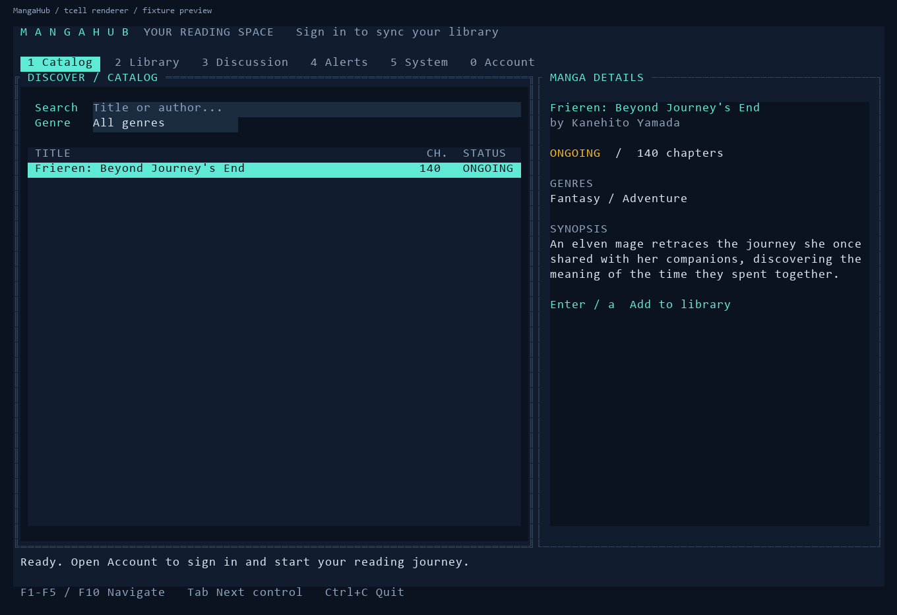
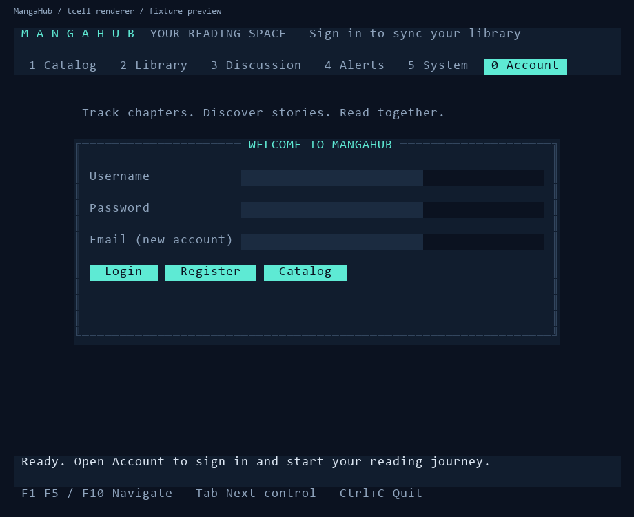

# MangaHub TUI guide

The redesigned client keeps the Go/tview interface and the existing backend protocols. Use Go 1.25.1 or later. Run these commands from `mangahub-main/MangaHub-main`, each in a separate terminal:

```powershell
go run ./cmd/catalog
```

```powershell
go run ./cmd/backend
```

```powershell
go run ./cmd/tui
```

Open Account with F10 to register or log in. Catalog access requires authentication on the existing backend. An earlier saved session is restored automatically. If it has expired, log out and sign in again.

Catalog, backend and TUI automatically load `.env.local` from the working directory. Keep the file in the Go module directory used above. Existing PowerShell environment variables take priority; open a fresh terminal if an old override should no longer apply. Restart programs after editing the file. The local file is ignored by Git.

## Navigation

| Key | Action |
|---|---|
| F1 / F2 / F3 / F4 / F5 / F10 | Catalog / Library / Discussion / Alerts / Connections / Account |
| 1 / 2 / 3 / 4 / 5 / 0 | Page shortcuts outside text inputs, dropdowns and account forms |
| Tab / Shift+Tab | Next / previous control within the current page |
| Alt+Right / Alt+Left | Next / previous page |
| Mouse click on the navigation | Open that page |
| Ctrl+C / Alt+Q | Quit and close client workers |

## Catalog and library

Press `/` to focus search, type a title or author, then Enter. Press `g` to choose a genre. `r` refreshes with the current filters. Use the arrow keys to select a title; its details appear beside the list, or below it in a narrow terminal. Tab moves into details so the synopsis can be scrolled.

Enter or `a` opens the add-to-library dialog. In Library, Enter edits chapter/status; `+` and `-` change the chapter directly. Escape cancels the progress dialog. The visible library retains its selected row during refresh. Progress totals use the current catalog cache; an unavailable total displays as unknown.

## Discussion and chapter alerts

Discussion opens at the message field. Tab moves to rooms, then conversation history, then back to the message. Select a room with the arrow keys and Enter. Enter sends a non-empty message asynchronously. If a send fails, the message remains available for retry.

In Alerts, `s` subscribes, `u` unsubscribes, `c` clears the feed, and `t` triggers the protected demo release endpoint. Set the same private `ADMIN_API_KEY` in the backend and teacher/demo TUI shell; a logged-in account is also required. Empty configuration disables release. A demo release changes the catalog's chapter count; use a disposable demo database when demonstrating this action. UDP delivery is best effort.

Connections shows the configured client addresses, backend/catalog health, and client connection flags. `r` refreshes it. The implemented identity checks and verification results are documented in [the grade readiness review](GRADE_A_REVIEW.md).

## Verification and previews

```powershell
go test ./internal/tui -count=1
go test -race ./internal/tui -count=1
```

The following previews were captured from the actual tcell renderer using fixture manga data. They illustrate layout, not a live networking demo:





For repeatable renderer snapshots:

```powershell
$env:TUI_CAPTURE_DIR = Join-Path $env:TEMP 'mangahub-tui-captures'
go test ./internal/tui -run TestRedesignScreens -count=1
```

This writes per-cell JSON snapshots for all six screens at 120x38 and 80x30. It does not modify the user's database or saved session.
